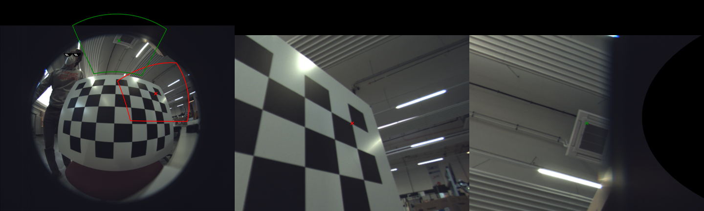
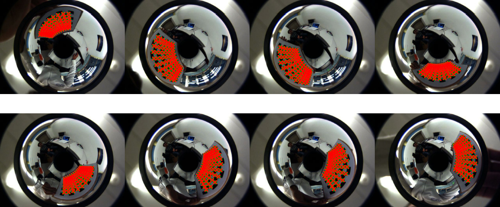
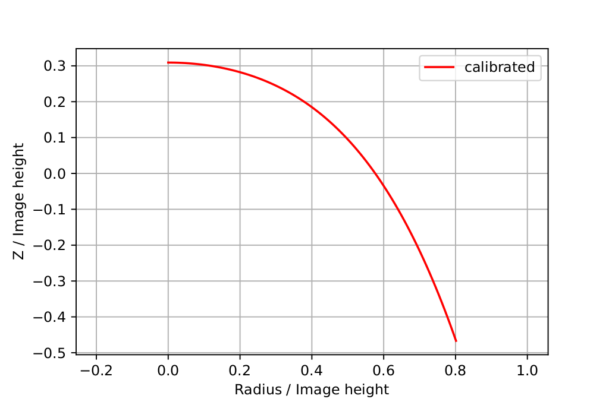
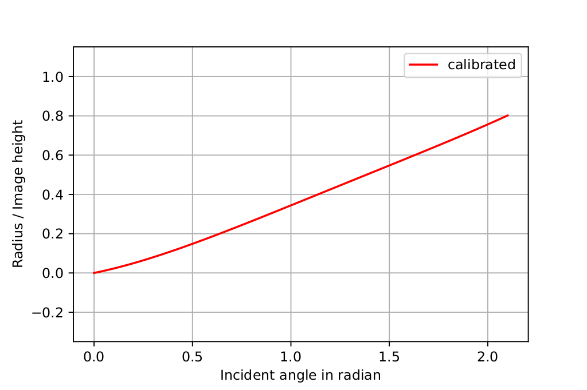

# Omnidirectional Camera Calibration
## Key features
 * pure python
 * initial solution based on [A Toolbox for Easily Calibrating Omnidirectional Cameras (Davide Scaramuzza, Agostino Martinelli, Roland Siegwart)](http://rpg.ifi.uzh.ch/docs/IROS06_scaramuzza.pdf)
 * Optimized solution via [Levenberg–Marquardt algorithm](https://en.wikipedia.org/wiki/Levenberg%E2%80%93Marquardt_algorithm) on reprojection error
 * Lie algebra based extrinsics optimization
 

([undistort example](doc/undistort.ipynb))
## Usage
1. Corner detection (see `python -m omnicalib.detect --help` for detailed argument description)
```
python -m omnicalib.detect --chessboard <rows> <columns> <square-size> --max-dim <max-dim> --threads <threads> <image-folder>
```
e.g.
```
python -m omnicalib.detect --chessboard 8 5 0.068 "./img"
```
The file `detections.pickle` is written, which contains a **pickled dictionary** with the following format

```
{
    'detections': {
        <image_path_0>: {'image_points': <image_points>, 'object_points': <object_points>},
        ...
}
```
 * Image paths (`pathlib.Path`) are absolute
 * `image_points` are `torch.Tensor` with shape `N x 2` and dtype `torch.float64`
 * `object_points` are `torch.Tensor` with shape `N x 3` and dtype `torch.float64` and third colum, the z coordinate, all zeros

 If an external corner detection method is used, this file can simply be written manually.

 2. Calibration (see `python -m omnicalib --help` for detailed argument description)
```
python -m omnicalib --degree <degree> detections.pickle
python -m omnicalib -c 2 detections.pickle
```
## Result
A `calibration.yml` file (see [example_calibration.yml](doc/example_calibration.yml)) containing
 * `extrinsics` as list of `3 x 4` matrices
 * `poly_incident_angle_to_radius`, a polynom that converts incident angle to image radius
 * `poly_radius_to_z`, a polynom that converts radius to z component of view vector
 * `principal_point` in pixel

## Conversion to OpenCV fisheye model
`yml_to_npz.py` converts a `calibration.yml` into an `.npz` file usable with the `cv2.fisheye` module (Kannala-Brandt model)
```
python yml_to_npz.py [calibration.yml] [-o <output.npz>] [-d detections.pickle] [--image-size <W> <H>] [--max-angle <degrees>] [--camera <name>]
```
e.g.
```
python yml_to_npz.py calibration.yml -d detections.pickle -o fisheye.npz --camera concFish1
```
The `.npz` file contains
 * `model`, always the string `"fisheye"`
 * `camera`, the camera name, if given with `--camera`
 * `K`, the `3 x 3` camera matrix with `fx = fy = f`, `(cx, cy) = principal_point` and zero skew
 * `D`, the `4 x 1` distortion coefficients `k1..k4` for `cv2.fisheye`
 * `theta_max`, the upper incident angle (radians) of the fitted range
 * `image_size` as `(W, H)`, if known (from `--image-size` or the first calibration image)

```python
import cv2, numpy as np
c = np.load('fisheye.npz')
map1, map2 = cv2.fisheye.initUndistortRectifyMap(c['K'], c['D'], np.eye(3), c['K'], tuple(c['image_size']), cv2.CV_16SC2)
```

### Method
`cv2.fisheye` models the image radius as `r(θ) = f·θ·(1 + k1·θ² + k2·θ⁴ + k3·θ⁶ + k4·θ⁸)`, i.e. odd powers of θ only, whereas `poly_incident_angle_to_radius` is a general polynom in θ. Since there is no exact conversion, `f` and `k1..k4` are fitted by linear least squares to `poly_incident_angle_to_radius` on `θ ∈ [0, θ_max]`.

`θ_max` is
 * the largest incident angle of all calibration points (computed from the `extrinsics`) if `--detections` is given, i.e. only the range supported by measurements
 * `89°` otherwise
 * overridden by `--max-angle`

and is always limited to
 * `< 90°`, because `cv2.fisheye` computes `θ = atan(|(x, y)| / z)` and cannot represent rays with `θ ≥ 90°`. Image regions of lenses with a larger field of view are not covered by the OpenCV model
 * the range in which `poly_incident_angle_to_radius` is monotonically increasing
 * the incident angle of the image corner farthest from the principal point (if the image size is known)

### Verification
The script prints
 * the radius error of the fit
 * the difference between `cv2.fisheye.projectPoints` and the omnicalib model on random rays within `[0, θ_max]`
 * with `--detections`: the reprojection error of both models against the detected image points

## Installation
Install the [latest wheel](https://github.com/tasptz/py-omnicalib/releases/latest) with
```
pip install https://github.com/tasptz/py-omnicalib/releases/download/<wheel_url>
```

## Method
For a detailed description see [method.md](doc/method.md).

## Simulation
Play with the calibration on simulated data with the provided [jupyter lab notebook](doc/simulation.ipynb). It generates randomized data for the following ideal projection models
 * equidistant
 * stereographic
 * orthographic
 * equisolid

 , see [Large Area 3D Human Pose Detection Via Stereo Reconstruction in Panoramic Cameras](https://arxiv.org/pdf/1907.00534.pdf) for a detailed description.

## Example
[Jupyter lab notebook](doc/example.ipynb), [example results](doc/example_calibration.yml)







## Citation
If you would like to reference this work, see the following BibTeX suggestion
```
@misc{pyomnicalib,
  author = {Pönitz, Thomas},
  title = {Python Omnidirectional Camera Calibration},
  publisher = {GitHub},
  journal = {GitHub repository},
  howpublished = {\url{https://github.com/tasptz/py-omnicalib}}
}
```

## Changelog
```
2024-12-05  V1.1.0   added GPU support
```